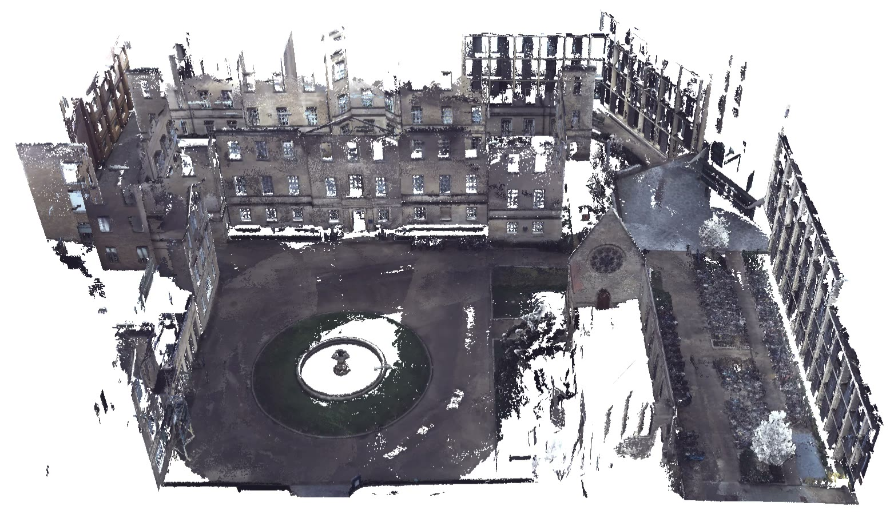

<div align="center">
  <h1>Occupancy Planar Patch: Incremental Probabilistic Bounded-Plane Reconstruction from LiDAR Data</h1>
  <p>
    <a href="https://jiahao.wang/" target="_blank">Jiahao Wang</a><sup>1</sup>,
    <a href="https://chaehyeonsong.github.io/" target="_blank">Chaehyeon Song</a><sup>2</sup>,
    <a href="https://scholar.google.com/citations?user=aGvNBOoAAAAJ" target="_blank">Dongjiao He</a><sup>1</sup>,
    <a href="https://janquenzel.github.io/" target="_blank">Jan Quenzel</a><sup>1</sup>,
    <a href="https://ori.ox.ac.uk/people/lintong-zhang/" target="_blank">Lintong Zhang</a><sup>3</sup>,
    <a href="https://ayoungk.github.io/" target="_blank">Ayoung Kim</a><sup>2</sup>,
    <a href="https://ori.ox.ac.uk/people/maurice-fallon/" target="_blank">Maurice Fallon</a><sup>1</sup><br>
    <sup>1</sup>Dynamic Robot Systems Group, University of Oxford &nbsp;&nbsp;
    <sup>2</sup>Seoul National University &nbsp;&nbsp;
    <sup>3</sup>NavLive
  </p>

  [](https://dynamic.robots.ox.ac.uk/docs/assets/papers/2026_wang_opp.pdf)
  [](https://youtu.be/lkPlSdKEf1M)
  [](https://jiahao.wang/opp)

  
</div>

Occupancy Planar Patch (OPP) is an incremental bounded planar patch representation for online surface reconstruction from LiDAR. It evaluates surface likelihoods and free space directly in range-space, so sensor noise, plane uncertainty and ray clearance are modelled explicitly during reconstruction. A single ray-to-patch association weight jointly updates plane geometry, refines surface boundaries, and blends camera imagery.

Evaluated on six sequences from the [Oxford Spires](https://dynamic.robots.ox.ac.uk/datasets/oxford-spires/) and [MCD](https://mcdviral.github.io/) datasets, OPP achieves the highest precision and lowest reconstruction error among the evaluated methods, while producing stored maps among the most compact. Geometric reconstruction runs in real time.

## 🗺️ 3D Models

Reconstructed 3D models from the paper will be added here shortly. In the meantime, you can explore them interactively on the [project page](https://jiahao.wang/opp).

## 💻 Code

🚧 **Code release coming soon.** Watch this repository to be notified.

## 📝 Citation

```bibtex
@misc{wang2026opp,
  title  = {Occupancy Planar Patch: Incremental Probabilistic Bounded-Plane Reconstruction from LiDAR Data},
  author = {Wang, Jiahao and Song, Chaehyeon and He, Dongjiao and Quenzel, Jan and Zhang, Lintong and Kim, Ayoung and Fallon, Maurice},
  year   = {2026}
}
```
