<div align="center">
  <h1>Occupancy Planar Patch: Incremental Probabilistic Bounded-Plane Reconstruction from LiDAR Data</h1>
  <p>
    <a href="https://jiahao.wang/" target="_blank">Jiahao Wang</a><sup>1</sup>,
    <a href="https://chaehyeonsong.github.io/" target="_blank">Chaehyeon Song</a><sup>2</sup>,
    <a href="https://scholar.google.com/citations?user=aGvNBOoAAAAJ" target="_blank">Dongjiao He</a><sup>1</sup>,
    <a href="https://janquenzel.github.io/" target="_blank">Jan Quenzel</a><sup>1</sup>,
    <a href="https://ori.ox.ac.uk/people/lintong-zhang/" target="_blank">Lintong Zhang</a><sup>3</sup>,
    <a href="https://ayoungk.github.io/" target="_blank">Ayoung Kim</a><sup>2</sup>,
    <a href="https://ori.ox.ac.uk/people/maurice-fallon/" target="_blank">Maurice Fallon</a><sup>1</sup><br>
    <sup>1</sup>University of Oxford &nbsp;&nbsp;
    <sup>2</sup>Seoul National University &nbsp;&nbsp;
    <sup>3</sup>NavLive
  </p>

  [](https://arxiv.org/abs/2611.28403)
  [](https://youtu.be/lkPlSdKEf1M)
  [](https://jiahao.wang/opp)

  
</div>

Occupancy Planar Patch (OPP) is an incremental bounded planar patch representation for online surface reconstruction from LiDAR. It evaluates surface likelihoods and free space directly in range-space, so sensor noise, plane uncertainty and ray clearance are modelled explicitly during reconstruction. A single ray-to-patch association weight jointly updates plane geometry, refines surface boundaries, and blends camera imagery.

Evaluated on six sequences from the [Oxford Spires](https://dynamic.robots.ox.ac.uk/datasets/oxford-spires/) and [MCD](https://mcdviral.github.io/) datasets, OPP achieves the highest precision and lowest reconstruction error among the evaluated methods, while producing stored maps among the most compact. Geometric reconstruction runs in real time.

## 💻 Code

🚧 **Code release coming soon.** Watch this repository to be notified.

## 🌐 Live Demo

The [project page](https://jiahao.wang/opp) features an in-browser viewer with reconstruction cut-outs and interactive method comparisons.

## 🗺️ Reconstruction Results

Ahead of the code release, you can inspect OPP's reconstruction quality for yourself.

**Download.** Textured reconstructions of the six evaluation sequences, at the full texture resolution used in the paper, are available as [GLB](https://www.khronos.org/gltf/) files from the [`models-v1` release](https://github.com/ori-drs/occupancy_planar_patch/releases/tag/models-v1). Each also comes as a patch-colour model: the same patches without texture, each in its own colour, which shows the reconstructed geometry also where no camera observed it.

| Textured | Patches | Dataset | Sequence | Patches | Textured GLB | Patch-colour GLB |
|---|---|---|---|---:|---|---|
| <a href="media/models/bodleian02.jpg">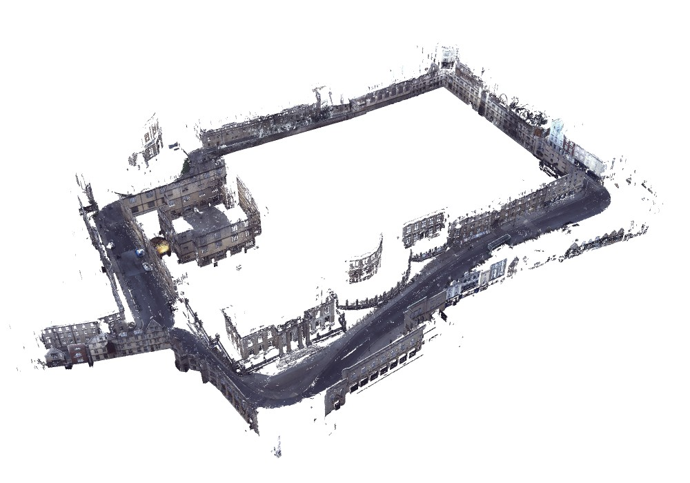</a> | <a href="media/models/bodleian02_patches.jpg">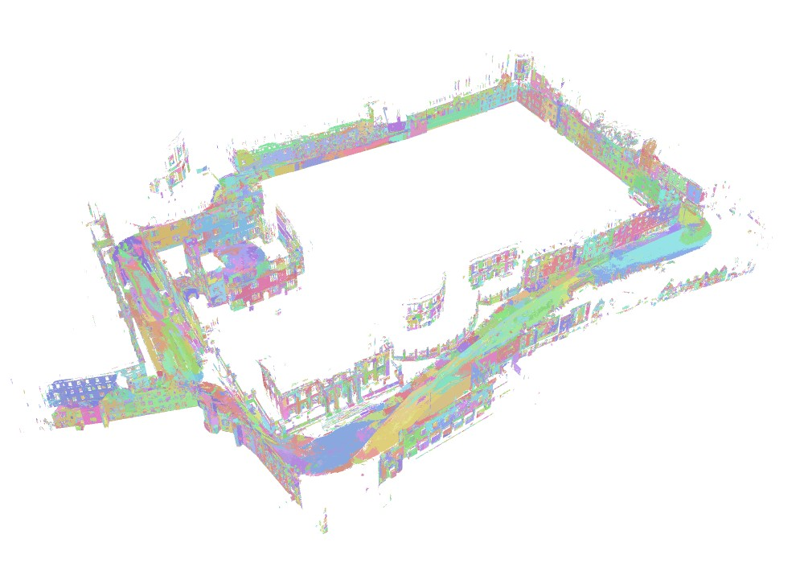</a> | Oxford Spires | bodleian02 | 47,834 | [bodleian02.glb](https://github.com/ori-drs/occupancy_planar_patch/releases/download/models-v1/bodleian02.glb) (224 MB) | [bodleian02_patches.glb](https://github.com/ori-drs/occupancy_planar_patch/releases/download/models-v1/bodleian02_patches.glb) (27 MB) |
| <a href="media/models/keble03.jpg">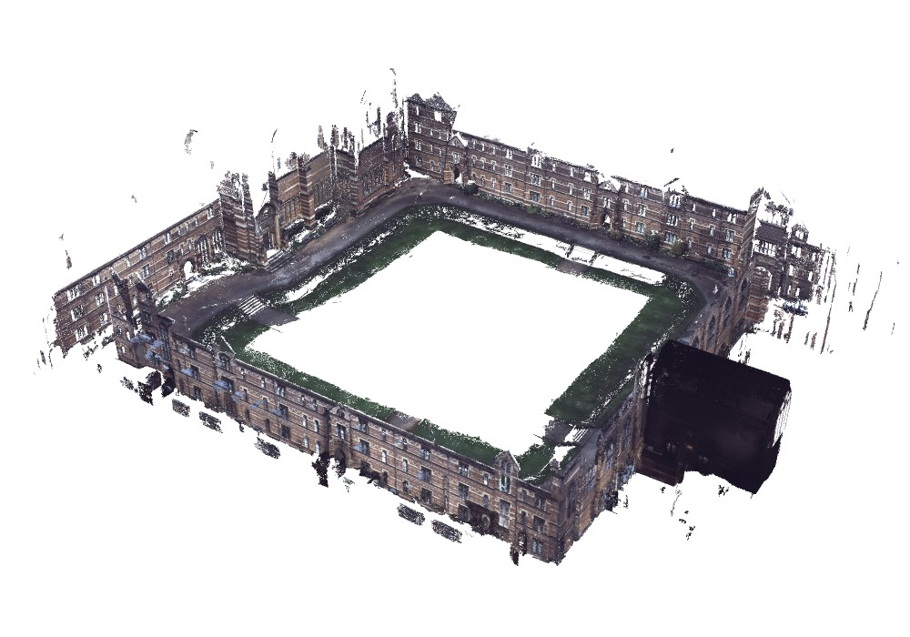</a> | <a href="media/models/keble03_patches.jpg">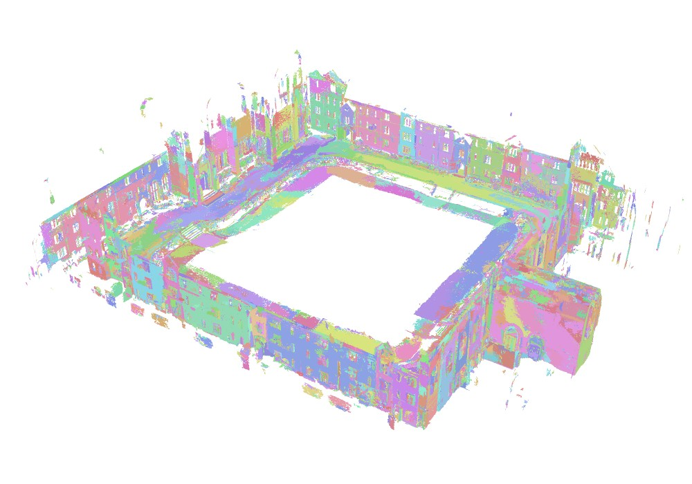</a> | Oxford Spires | keble03 | 15,002 | [keble03.glb](https://github.com/ori-drs/occupancy_planar_patch/releases/download/models-v1/keble03.glb) (67 MB) | [keble03_patches.glb](https://github.com/ori-drs/occupancy_planar_patch/releases/download/models-v1/keble03_patches.glb) (8 MB) |
| <a href="media/models/observatory01.jpg">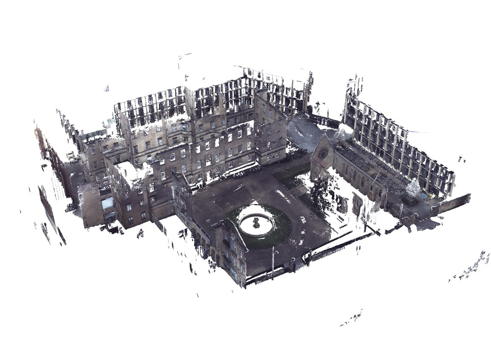</a> | <a href="media/models/observatory01_patches.jpg">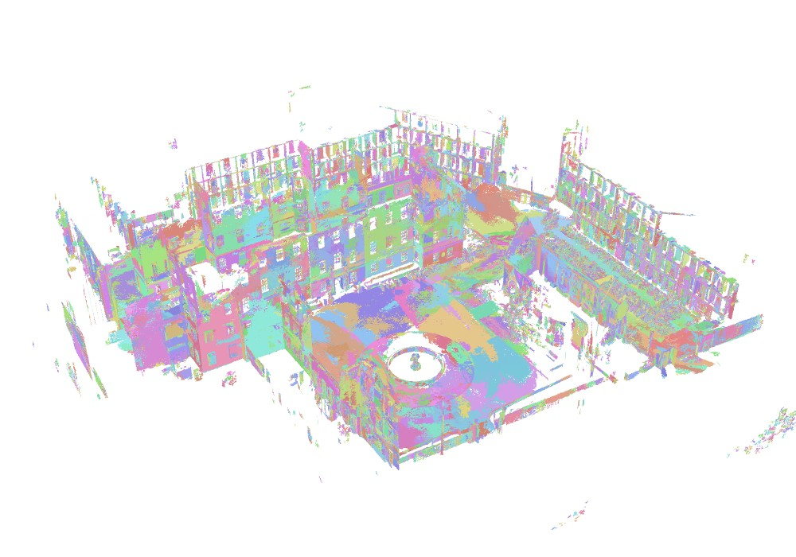</a> | Oxford Spires | observatory01 | 33,688 | [observatory01.glb](https://github.com/ori-drs/occupancy_planar_patch/releases/download/models-v1/observatory01.glb) (119 MB) | [observatory01_patches.glb](https://github.com/ori-drs/occupancy_planar_patch/releases/download/models-v1/observatory01_patches.glb) (15 MB) |
| <a href="media/models/kth_day_10.jpg">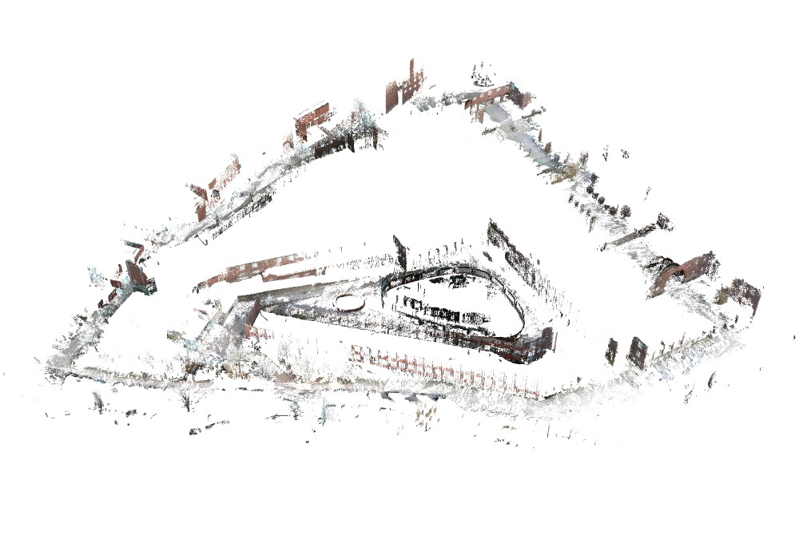</a> | <a href="media/models/kth_day_10_patches.jpg">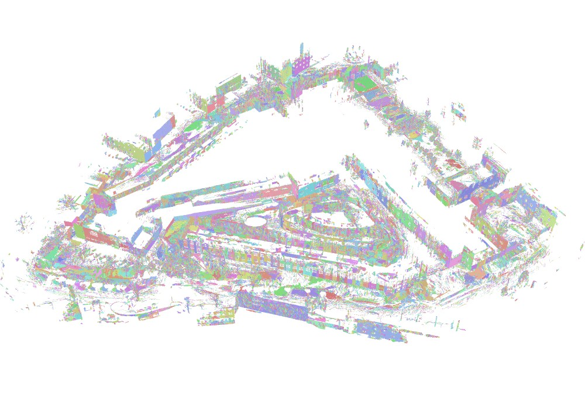</a> | MCD\* | kth_day_10 | 89,298 | [kth_day_10.glb](https://github.com/ori-drs/occupancy_planar_patch/releases/download/models-v1/kth_day_10.glb) (132 MB) | [kth_day_10_patches.glb](https://github.com/ori-drs/occupancy_planar_patch/releases/download/models-v1/kth_day_10_patches.glb) (49 MB) |
| <a href="media/models/ntu_day_02.jpg">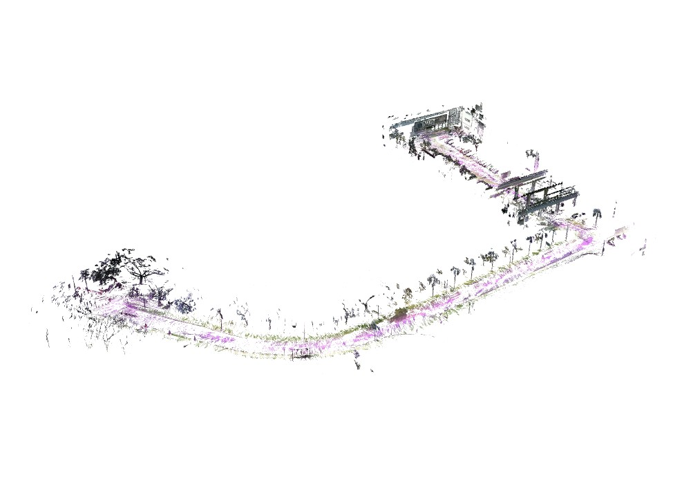</a> | <a href="media/models/ntu_day_02_patches.jpg">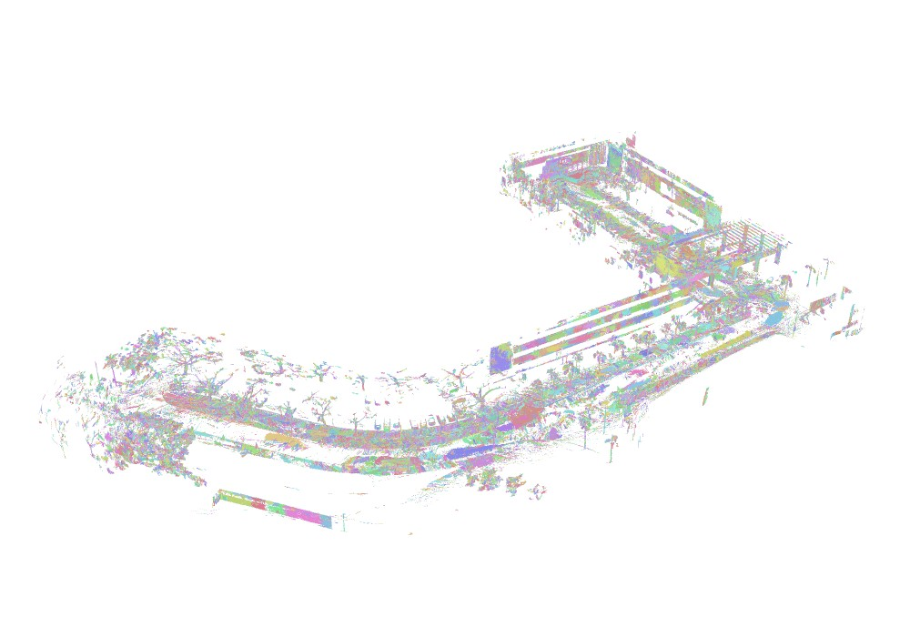</a> | MCD\* | ntu_day_02 | 59,120 | [ntu_day_02.glb](https://github.com/ori-drs/occupancy_planar_patch/releases/download/models-v1/ntu_day_02.glb) (52 MB) | [ntu_day_02_patches.glb](https://github.com/ori-drs/occupancy_planar_patch/releases/download/models-v1/ntu_day_02_patches.glb) (27 MB) |
| <a href="media/models/tuhh_day_02.jpg">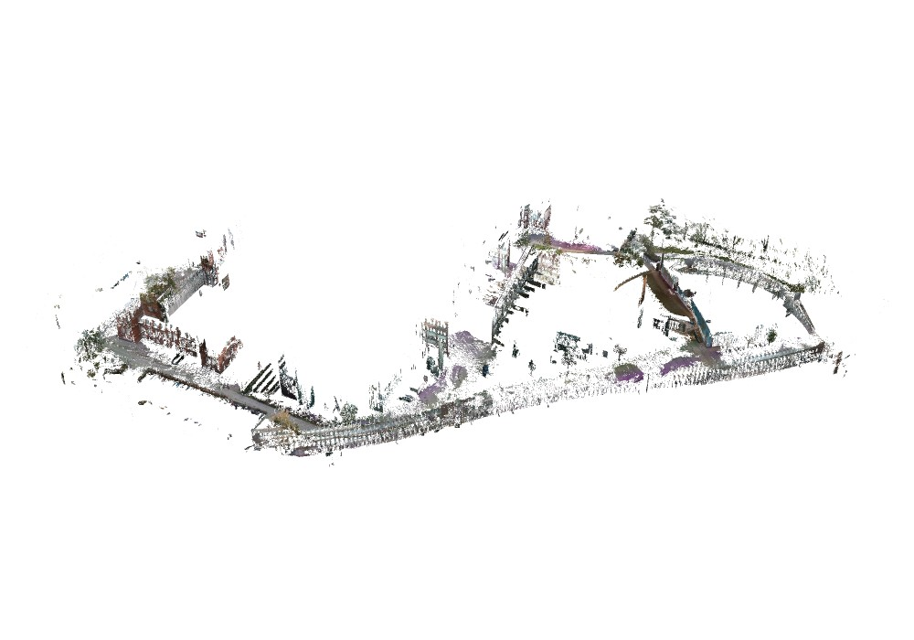</a> | <a href="media/models/tuhh_day_02_patches.jpg">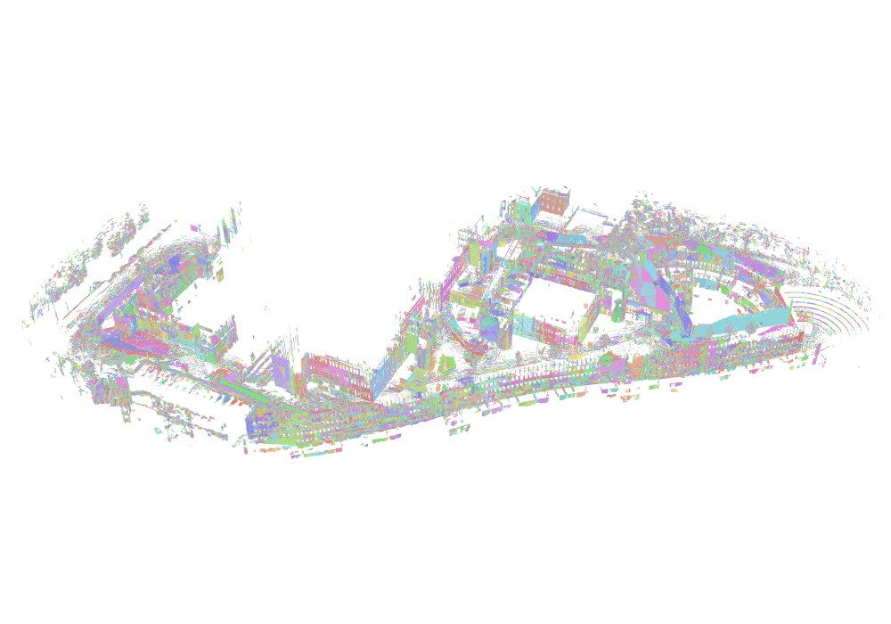</a> | MCD\* | tuhh_day_02 | 82,133 | [tuhh_day_02.glb](https://github.com/ori-drs/occupancy_planar_patch/releases/download/models-v1/tuhh_day_02.glb) (104 MB) | [tuhh_day_02_patches.glb](https://github.com/ori-drs/occupancy_planar_patch/releases/download/models-v1/tuhh_day_02_patches.glb) (42 MB) |

\* **Due to single-camera coverage, the MCD sequences are mostly untextured; the patch-colour models show the full reconstructed geometry.**

**Viewing.** Open a file in [gltf-viewer.donmccurdy.com](https://gltf-viewer.donmccurdy.com/) or import it into [Blender](https://www.blender.org/) (File → Import → glTF 2.0).

**File sizes.** These include the camera textures, so they are larger than the texture-free map sizes reported in the paper (e.g. 30.2 MiB for Keble03).

## 📝 Citation

```bibtex
@misc{wang2026opp,
  title  = {Occupancy Planar Patch: Incremental Probabilistic Bounded-Plane Reconstruction from LiDAR Data},
  author = {Wang, Jiahao and Song, Chaehyeon and He, Dongjiao and Quenzel, Jan and Zhang, Lintong and Kim, Ayoung and Fallon, Maurice},
  year   = {2026}
}
```
